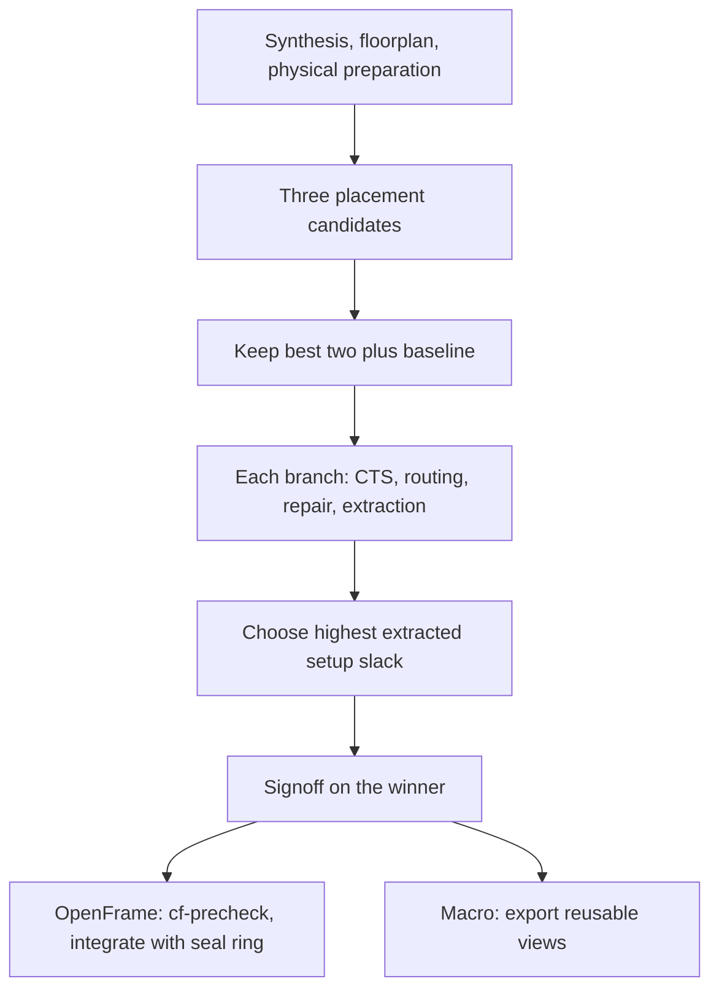

# Example flows

Part of the [SiPath documentation](../README.md#documentation).

Recipes, one feature each: a design-file snippet, the command, and what to look
at afterwards. A snippet with `flow:` replaces the `flow:` of a design file (the
rest of the file stays as it is); every snippet here is checked against the
design-file schema and the declared step parameters by the unit tests, so the
names are the ones SiPath accepts. Full designs for most recipes are in
`sipath/examples/` ([design files and examples](design-files.md)). The
[tutorial notebook](../notebooks/sipath_tutorial.ipynb) runs most recipes, in
Colab or Codespaces (the hour-long mcu8 and OpenFrame runs are left commented
out there).

- [1. RTL to a signed-off layout](#1-rtl-to-a-signed-off-layout)
- [2. A first cut at PPA, then the clock](#2-a-first-cut-at-ppa-then-the-clock)
- [3. Synthesis: recipes, front ends, the fallback](#3-synthesis-recipes-front-ends-the-fallback)
- [4. Placement variants chosen by a score](#4-placement-variants-chosen-by-a-score)
- [5. Hard macros: comparing placers](#5-hard-macros-comparing-placers)
- [6. Analog nets: guard, shields, coupling limits](#6-analog-nets-guard-shields-coupling-limits)
- [7. A full die with a pad ring](#7-a-full-die-with-a-pad-ring)
- [8. An OpenFrame chip, prechecked, with its seal ring](#8-an-openframe-chip-prechecked-with-its-seal-ring)
- [9. Hardened macros in a parent design](#9-hardened-macros-in-a-parent-design)
- [10. Signoff checks one by one, and your own step](#10-signoff-checks-one-by-one-and-your-own-step)
- [11. Resume, and a step under another name](#11-resume-and-a-step-under-another-name)
- [12. An ECO from Python](#12-an-eco-from-python)
- [13. Driving a run from an agent (MCP)](#13-driving-a-run-from-an-agent-mcp)
- [14. Regression limits and repeated runs](#14-regression-limits-and-repeated-runs)
- [15. Design-space exploration: sweeps at several steps, in parallel](#15-design-space-exploration-sweeps-at-several-steps-in-parallel)
- [16. Heatmaps and adaptive rounds: hotspots into the next placement](#16-heatmaps-and-adaptive-rounds-hotspots-into-the-next-placement)
- [17. Route-aware search: an OpenFrame wrapper and a reusable macro](#17-route-aware-search-an-openframe-wrapper-and-a-reusable-macro)

## 1. RTL to a signed-off layout

The smallest design file: RTL, constraints and a target utilization. Without a
`flow:` list SiPath runs its default chain, synthesis to signoff.

```yaml
name: gcd8
top: gcd8
mode: macro
pdk: sky130A
rtl: [rtl/gcd8.v]
sdc: rtl/gcd8.sdc
core_utilization: 0.4
```

```bash
python3 -m sipath run my_gcd8.yaml runs/gcd8 --snapshots   # a picture after every step (_pictures/)
python3 -m sipath render runs/gcd8 all          # or afterwards: runs/gcd8/_pictures/place.0.png, ...
python3 -m sipath report runs/gcd8
```

`sipath render runs/gcd8 place` draws one step (its selected attempt);
`place.1` names an attempt, a rejected one too. Look at
`runs/gcd8/report.html` (every step, its attempts and metrics, the signoff
checks, the pictures in flow order) and `signoff/0/signoff.json` (DRC, LVS,
antennas, nine-corner timing). `sipath/examples/gcd8.yaml` is this design with
its flow spelled out (at 0.35 utilization).

## 2. A first cut at PPA, then the clock

Before a full run, `--explore` runs the design's flow to global routing in
about a minute and suggests a clock.

```bash
python3 -m sipath run sipath/examples/gcd8.yaml runs/gcd8_explore --explore
```

`ppa.md` gives cell area, utilization, WNS/TNS/WHS, power, wirelength, and per
clock the achievable period and a suggested `create_clock`. Put that period in
the SDC, then run the full flow (recipe 1).

## 3. Synthesis: recipes, front ends, the fallback

The synth step maps with several ABC recipes in one attempt and keeps the
smallest netlist that meets timing. Choose the recipe set, the corner and what
to do when nothing meets timing:

```yaml
flow:
- step: synth
  variants: [{abc_sweep: balanced, synth_fallback: least_area}]
- step: floorplan
- step: physical
- step: place
- step: cts
- step: route_analog
- step: route_digital
- step: route_repair
- step: extract
- step: signoff
```

Or make every recipe × front end a separate attempt (Booth multipliers,
prefix adders), picked by `synth_select`:

```yaml
flow:
- step: synth
  sweep: delay
  synth_opts_sweep: [[], [booth], [adder=kogge-stone], [adder=han-carlson]]
```

The selected attempt's `abc_sweep.why` says which recipe won and why; the
[synthesis bench](benchmarks.md#synthesis-bench) has measured numbers.

## 4. Placement variants chosen by a score

Any step takes `variants` (one attempt each, run `parallel` at a time) and a
named `score` that picks the one the next step continues from; the others stay
in `graph.json`.

```yaml
flow:
- step: synth
- step: floorplan
- step: physical
- step: place
  variants: [{density: 0.5}, {density: 0.6}, {density: 0.7, routability_driven: false}]
  score: routability_then_wns
  parallel: 3
- step: cts
- step: route_analog
- step: route_digital
- step: route_repair
- step: extract
- step: signoff
```

`routability_then_wns` ranks by global-route overflow first, so a congested
variant loses on score rather than failing later. Other scores: `auto` (setup
slack when constrained, else wirelength), `setup_wns`, `wns_then_hpwl`,
`drc_then_slack`, `macro_quick`, `synth_select`; plugins register more, and
MCP's `list_scores` lists them all.

## 5. Hard macros: comparing placers

Macros without a `location` are placed by the `macros` step. Three methods,
each checked against the same rules (halo, channel, pin clearance, analog
guard) and scored by a quick place and route:

```yaml
macros:
- {inst: "bank[0].u_ram", sram: sky130_sram_1kbyte_1rw1r_32x256_8, halo: 15,
   supplies: {"^vccd1$": VDD, "^vssd1$": VSS}}
keepouts: [[0, 0, 100, 100]]
macro_channel: 30
flow:
- step: synth
- step: floorplan
- step: macros
  variants: [{method: random, seed: 1}, {method: random, seed: 2}, {method: mpl},
             {method: cdlns, placer_seconds: 120}]
  score: macro_quick
  parallel: 4
```

`cdlns` needs the placer's Python once: `python3 -m sipath setup-placer`.
`sipath/examples/sram8.yaml` is eight SRAMs placed this way; the
[macro placement benchmark](benchmarks.md#macro-placement) compares the
methods.

## 6. Analog nets: guard, shields, coupling limits

Analog nets are routed first with a wide rule and frozen; later digital wiring
keeps that spacing. Shield the sensitive ones and bound their coupling:

```yaml
analog_nets: [ana_in, vref]
analog_shield: [ana_in]          # grounded wires on both sides
analog_keepaway: true            # no digital wiring on the layers above and below
flow:
- step: synth
- step: floorplan
- step: physical
- step: place
- step: cts
- step: route_analog
  variants: [{shield_tie_um: 30}]
- step: route_digital
- step: route_repair
- step: extract
  variants: [{max_analog_coupling_ff: 1.5, max_analog_aggressor_ff: 0.5}]
- step: signoff
```

`route_analog`'s outputs give each shielded net's coverage; `extract` writes
`analog_coupling.md` (each analog net's coupling to digital nets and its worst
aggressors) and fails above the limits. `sipath/examples/dp8.yaml` and
`mcu8.yaml` shield their analog nets ([analog coupling](benchmarks.md#analog-coupling)).

## 7. A full die with a pad ring

`mode: die` generates the pad ring from rules (supply pairs on every edge,
analog pads next to their supplies, every IO control pin tied) and routes 3.3 V
analog supplies from their pads:

```yaml
name: chip
top: chip
mode: die
pdk: sky130A
netlist: rtl/chip_flat.v
sdc: rtl/chip.sdc
die: [0, 0, 1500, 1500]
core_margin: 241
pads:
- {inst: pad_clk, edge: west, order: 0, master: sky130_ef_io__gpiov2_pad_wrapped}
pad_kinds: {pad_clk: input}
pad_supplies: {"^VCCD$": VDD}
analog_supplies: [VDDA, VSSA]
```

`sipath/examples/mcu8.yaml` is a complete die: 39 pads, an SRAM, an ADC and a
DAC, analog nets shielded; `python3 -m sipath run mcu8`.

## 8. An OpenFrame chip, prechecked, with its seal ring

A harness makes the design the frame's wrapper (template die and pins, frame
supplies, power grid). After signoff, ChipFoundry's own precheck runs on the
exported project, and `integrate` puts the wrapper into the frame's layout
with the seal ring:

```bash
python3 -m sipath new myproj --template openframe --set inputs=8 --set outputs=6
# once: the Magic image first (integrate and the precheck image use it), then the precheck image on it
docker build --platform linux/amd64 -t sipath/orfs-magic:8.3.685 docker/magic
docker build --platform linux/amd64 -t sipath/precheck:1.3.7 docker/precheck
```

The defaults name these images by the digests locked in
`sipath/toolchain.json` (`images.magic`, `images.precheck`). An image built
on another machine gets another digest, so point the configuration at yours.
Where Docker gives a local build a repository digest (Docker Desktop's
containerd store: `docker image inspect --format '{{json .RepoDigests}}'
sipath/orfs-magic:8.3.685` lists one), pin it:

```bash
export SIPATH_MAGIC_IMAGE="$(docker image inspect --format '{{index .RepoDigests 0}}' sipath/orfs-magic:8.3.685)"
export SIPATH_PRECHECK_IMAGE="$(docker image inspect --format '{{index .RepoDigests 0}}' sipath/precheck:1.3.7)"
```

Otherwise (the classic engine keeps none for a local build) name the tags and
allow unpinned images, which the run's provenance then records:

```bash
export SIPATH_MAGIC_IMAGE=sipath/orfs-magic:8.3.685 SIPATH_PRECHECK_IMAGE=sipath/precheck:1.3.7 SIPATH_REQUIRE_DIGEST=0
```

`python3 -m sipath toolchain --check` shows which images are configured and
whether they are the locked ones.

```yaml
flow:
- step: synth
- step: floorplan
- step: physical
- step: place
- step: cts
- step: route_analog
- step: route_digital
- step: route_repair
- step: extract              # no fill: the example wrapper passes the precheck's density check without it;
- step: signoff              #   add - step: fill before extract for a design that needs it
- step: precheck
- step: integrate
  variants: [{seal_ring: true}]
```

`precheck`'s outputs list every cf-precheck check (LVS with Netgen, OEB with
CVC, XOR, KLayout DRC, ...); `integrate`'s `chipcheck` confirms the die, the
wrapper at its origin and unchanged, and the seal ring centred and touching
nothing. `sipath/examples/openframe_gcd8.yaml` is a gcd on the east-edge pads;
its own flow integrates without the seal ring and has no `precheck`: add
those as above (its live test does).

## 9. Hardened macros in a parent design

Harden a signed-off design into views (abstract LEF, Liberty per corner, GDS,
SPEF, netlists), then place it in a parent:

```bash
python3 -m sipath harden gcd8 sipath/examples/hardened/gcd8
```

```yaml
macros:  # views: relative to the design file (here one in sipath/examples/)
- {inst: u0, views: hardened/gcd8, location: [20, 20]}
- {inst: u1, views: hardened/gcd8, location: [160, 20]}
```

The parent signs off with the macros' insides checked (DRC sees their layout,
LVS their netlist); `sipath/examples/gcd8_pair.yaml` does this with two gcd8.

## 10. Signoff checks one by one, and your own step

Each signoff check is also a step (its own process, resumable, its own
variants), and a step function can be named by import path:

```yaml
flow:
- step: synth
- step: floorplan
- step: physical
- step: place
- step: cts
- step: route_analog
- step: route_digital
- step: route_repair
- step: extract
- step: drc
- step: lvs
- step: timing
  variants: [{require: [setup, hold]}]
- step: mypkg.checks:inst_count
  variants: [{at_least: 100}]
```

```python
# mypkg/checks.py
from sipath.params import Param


def inst_count(ctx):
    """A step: counts instances (OpenROAD session in ctx.session) and checks a floor."""
    n = int(ctx.session.value("llength [[ord::get_db_block] getInsts]"))
    ctx.metrics["user_insts"] = n
    if n < ctx.params["at_least"]:
        raise RuntimeError(f"only {n} instances")


inst_count.params = [Param("at_least", "int", 1, "fewest instances accepted", min=0)]
inst_count.requires, inst_count.provides = {"netlist"}, set()  # what it reads, what it adds
```

A step declares what it needs from the steps before it and what it adds (see
[what each step needs](flow.md#what-each-step-needs)); one that declares
nothing runs unchecked, with a warning.

A whole package of steps, scores, checks and harnesses registers through
`plugins: [mypkg.sipath_ext]` (`sipath/examples/plugin_example.py`).

## 11. Resume, and a step under another name

An interrupted run continues where it stopped; finished attempts are kept. A
step whose inputs changed since (an edited SDC, RTL or macro view, another PDK
release or image) runs again with every step after it, never reused silently;
its old attempts stay in `graph.json` as `stale`, with the reason:

```bash
python3 -m sipath run mcu8 runs/mcu8 --resume
```

A step can run again under another name with `fn:`, for example a quick
signoff of a few checks before the full one:

```yaml
flow:
- step: synth
- step: floorplan
- step: physical
- step: place
- step: cts
- step: route_analog
- step: route_digital
- step: route_repair
- step: extract
- step: signoff_quick
  fn: signoff
  variants: [{checks: [drc, setup, hold], require: [drc, setup, hold]}]
- step: signoff
```

## 12. An ECO from Python

ECOs (resize, buffer) continue from the head of a run, are checked for
structural equivalence before routing, re-route only the touched nets and are
rejected if setup or hold slack drops by more than `max_slack_loss`:

```python
from sipath import designfile

flow = designfile.run("sipath/examples/dp8.yaml", "runs/dp8")
head = flow.steps["signoff"].selected
eco = flow.eco("eco1", head, [
    {"op": "resize", "inst": "u_acc.x_0", "master": "sky130_fd_sc_hd__xor2_2"},
    {"op": "buffer", "net": "u_acc.n_3", "master": "sky130_fd_sc_hd__buf_2"},
])
print(eco.selected.metrics["wns"], eco.selected.outputs.get("equivalence"))
```

## 13. Driving a run from an agent (MCP)

`python3 -m sipath mcp` serves the tools on stdio; register it with an MCP
client as a command. A session, as tool calls. Every step but the first names
its `parent`: the attempt the previous call's result reports as `selected`
(only a selected attempt may be continued):

```text
open_run      {"design": "gcd8", "workdir": "runs/agent_gcd8"}                     -> run_id R
run_step      {"run_id": R, "step": "synth"}                                        -> selected synth.0
run_step      {"run_id": R, "step": "floorplan", "parent": "synth.0"}               -> floorplan.0
run_step      {"run_id": R, "step": "physical", "parent": "floorplan.0"}            -> physical.0
run_step      {"run_id": R, "step": "place", "parent": "physical.0",
               "variants": [{"density": 0.5}, {"density": 0.7}],
               "score": "routability_then_wns", "parallel": 2, "background": true}  -> job_id J
job_status    {"job_id": J}                       (progress, then the result: place.0 and place.1, one selected, say place.1)
list_attempts {"run_id": R, "step": "place"}
get_outputs   {"run_id": R, "attempt": "place.1"}                                   (metrics, reports, files)
render_checkpoint {"run_id": R, "attempt": "place.1"}                               (a layout picture)
query_heatmap {"run_id": R, "attempt": "place.1", "map": "rudy"}                    (congestion: peak, hotspots)
run_step      {"run_id": R, "step": "cts", "parent": "place.1"}                     -> cts.0
run_step      {"run_id": R, "step": "route_analog", "parent": "cts.0"}              -> route_analog.0
run_step      {"run_id": R, "step": "route_digital", "parent": "route_analog.0"}    -> route_digital.0
run_step      {"run_id": R, "step": "route_repair", "parent": "route_digital.0"}    -> route_repair.0
run_step      {"run_id": R, "step": "fill", "parent": "route_repair.0"}             -> fill.0
run_step      {"run_id": R, "step": "extract", "parent": "fill.0"}                  -> extract.0
run_step      {"run_id": R, "step": "signoff", "parent": "extract.0"}               -> signoff.0
run_eco       {"run_id": R, "parent": "signoff.0",
               "ops": [{"op": "resize", "inst": "_152_", "master": "sky130_fd_sc_hd__nand2_4"}]}   (a NAND2 of gcd8's netlist)
```

An ECO continues from the head of the run: a selected attempt nothing has
continued from yet (here `signoff.0`). The live tests run this session as
printed (`LiveDocs`), so it stays true. The attempt numbers are what this run
gives; a retried attempt is numbered after the others, so read each one from
the result rather than assuming `.0`.

`describe_step` gives any step's parameters as a JSON Schema; arguments are
checked before anything runs ([agents](agents.md)).

## 14. Regression limits and repeated runs

Freeze a good run's results as limits, then check later runs against them:

```bash
python3 -m sipath limits runs/gcd8 gcd8 --suggest      # an entry for sipath/tests/limits.yaml
python3 -m sipath limits runs/gcd8 gcd8                # exit 1 on a violation
```

Compare configurations over repeated runs (median, min and max of each
metric, and where identical inputs diverge step by step):

```bash
python3 bench/repeat_compare.py aes --repeats 2 \
    --config knee:synth.synth_fallback=knee --config least_area:synth.synth_fallback=least_area
```

The live tests check their runs against `limits.yaml`, nightly in CI
([tests, limits and CI](testing.md)).

## 15. Design-space exploration: sweeps at several steps, in parallel

`sipath/examples/gcd8_explore.yaml` sweeps three steps of gcd8 at a 4 ns clock.
Each step runs its variants side by side, its `score` selects one, and the next
step continues from that one only, so the run follows the best path found so
far rather than every combination (2 + 3 + 2 attempts, not 2 × 3 × 2):

```yaml
config: {parallel_cap: 4}    # most attempts alive at once, across the run
flow:
- step: synth                # two recipe sets, each swept inside its attempt
  variants: [{abc_sweep: delay}, {abc_sweep: area}]
  score: synth_select
  parallel: 2
- step: floorplan
- step: physical
- step: place                # three densities, three at a time
  variants: [{density: 0.45}, {density: 0.6}, {density: 0.75}]
  score: routability_then_wns
  parallel: 3
- step: cts
- step: route_analog
- step: route_digital        # with and without repair on global-route parasitics
  variants: [{repair_after_grt: true}, {repair_after_grt: false}]
  score: drc_then_slack
  parallel: 2
- step: route_repair
- step: fill
- step: extract
- step: signoff
```

First the quick sweep, then the full one:

```bash
python3 -m sipath run sipath/examples/gcd8_explore.yaml runs/gcd8_x --explore   # global routing only
python3 -m sipath run sipath/examples/gcd8_explore.yaml runs/gcd8_full          # to signoff
python3 -m sipath report runs/gcd8_full                                         # every attempt, why it lost
```

Measured (Apple-silicon Mac, amd64 image, 12 threads, while another long run
shared the machine):

| step | variant | full flow: result | selected |
|---|---|---|---|
| synth | `abc_sweep: delay` | `delay_map_resyn`, +0.519 ns at ss_max, 1,768 µm² | ✓ |
| synth | `abc_sweep: area` | `yosys_default`, −0.825 ns, 1,710 µm² | |
| place | `density: 0.45` | WNS +0.250 ns, HPWL 3,437 µm, no overflow | |
| place | `density: 0.6` | WNS +0.225 ns, HPWL 3,341 µm | |
| place | `density: 0.75` | WNS +0.300 ns, HPWL 3,209 µm | ✓ |
| route_digital | `repair_after_grt: true` | WNS +0.126 ns, DRC 0, 4,289 µm | ✓ |
| route_digital | `repair_after_grt: false` | WNS +0.056 ns, DRC 0, 4,124 µm | |

| run | attempts | wall time | result |
|---|---|---|---|
| `--explore` | 7 | 29 s | WNS +0.907 ns at tt (global-route parasitics); achievable 3.09 ns, suggested `create_clock -period 3.25` |
| full, in parallel (`parallel_cap: 4`, the file's) | 7 + the single steps | 76 s | signoff passes: DRC 0, LVS match, WNS +1.975 ns at tt, +0.126 ns at ss_max |
| full, one attempt at a time (the file with `parallel_cap: 1`) | the same | 105 s | identical: the same selections and numbers at every step |

The two full runs were measured on 2026-10-23 one after the other on an
otherwise idle machine. The design file's `config:` wins over `SIPATH_*`
variables, so `SIPATH_PARALLEL_CAP=1` does not make this file run one attempt
at a time: change the file's `parallel_cap`.

What this shows:
- **Parallelism changes the wall time, not the result.** Both full runs select
  the same attempts with the same metrics: the flow is deterministic, and
  attempts running at once share the run's OpenROAD threads (each gets
  `threads` / the attempts alive at once; a step's `threads` parameter
  overrides it). On a design this small the gain is 28% of the wall time; it
  grows with the attempts' length, e.g. mcu8's macro sweep.
- **Explore mode is a first look, judged at the typical corner.** There it
  picks the area recipe set (it meets 4 ns at tt); the full flow, judging at
  the slow corner, picks the delay set. In explore mode a routing score that
  needs the detailed router's DRC count (`drc_then_slack`) becomes
  `setup_wns`.
- **Every attempt stays.** `graph.json` holds each attempt's parameters,
  metrics, score and status (`selected` or `rejected`); `report.html` shows
  them; over MCP, `list_attempts` and `get_outputs` read them. To try another
  path, re-run the step with that variant alone (or a different `score`): a run
  continues only from a selected attempt.
- **An interrupted sweep resumes.** `--resume` keeps the attempts that
  finished (a sweep of three that stopped after two runs only the third) and
  re-runs nothing that is recorded.

## 16. Heatmaps and adaptive rounds: hotspots into the next placement

`place`, `cts`, `route_digital` and `extract` collect OpenROAD's heatmaps
after each checkpoint is saved ([heatmaps](flow.md#heatmaps)). `adapt` turns
the placement's hotspots into the next attempts:

```yaml
core_utilization: 0.65
flow:
- step: synth
- step: floorplan
- step: physical
- step: place
  variants: [{density: 0.8}]
  adapt: {rounds: 2}          # score: hotspots_then_wns unless one is given
  parallel: 2
- step: cts
- step: route_analog
- step: route_digital
- step: route_repair
  variants: [{drv_sizing: true}]
- step: fill
- step: extract
- step: signoff
```

On gcd8 (measured):

| attempt | from | parameters | hot share (placement) | setup WNS |
|---|---|---|---|---|
| place.0 | | density 0.8 | 20% | 4.614 ns |
| place.1 (selected) | place.0 | + blockages at 70% over 3 hotspots | 8% | 4.572 ns |
| place.2 | place.1 | + 2 more blockages | 16% | 4.592 ns |

The rounds stopped after the second ("no proposal scored better than the
selection"); a lower density was not proposed because the cells already fill
75% of the rows. The run signs off (DRC 0, LVS match) with `drv_sizing`, which
fixes one net the spread placement leaves 0.03 ns over the slew limit; slack
at the slow corner is 3.81 ns against 4.21 ns without the rounds. This design
has no routing congestion to relieve, so here the rounds cost slack for
nothing measurable downstream.

Look at the maps and the rounds afterwards:

```bash
python3 -m sipath report runs/dense
```

```text
query_heatmap {"run_id": R, "attempt": "place.0", "map": "placement"}     (peak, hotspots, bins)
adapt_step    {"run_id": R, "step": "place", "rounds": 1, "options": {"max_density": 60}}
```

## 17. Route-aware search: an OpenFrame wrapper and a reusable macro

**Before running OpenFrame:** install/configure both the Magic and cf-precheck
images as described in [PDKs and runtimes](pdks-and-runtimes.md). They are
required for precheck and chip integration. `--plan` does not check image
availability; run `python3 -m sipath doctor` and confirm both images are ready
before starting the physical flow.

The **route-aware search** recipe keeps multiple placements until their
routed parasitics are extracted. It uses the existing bounded-search
mechanism (`keep` / `decide_at`); both examples are ordinary design YAMLs.



The first placement variant is `{}`: the design's baseline parameters. The
other two use density 0.50 and 0.70. Placement ranks by global-route overflow,
then setup slack and wirelength (`routability_then_wns`); the best two and
the baseline, if otherwise excluded, continue through routing. This is at
most three routed branches. They run sequentially after the placement sweep;
the YAMLs allow at most three placements concurrently within the caller's
thread budget (`SIPATH_THREADS` or the runtime default).
The decision at `extract` uses `setup_wns`, so it measures extracted timing
rather than the placement estimate. Missing slack is ineligible.

The final signoff remains a separate requirement. The extraction score is
not all-corner signoff, and a winner can still fail hold, DRC or another
required check. Such a run fails honestly; it does not automatically try
the second-best branch. A failed branch is recorded with the decision;
cancellation or budget exhaustion stops the whole run for resume.

**Example 1: OpenFrame.**
[`openframe_gcd8_route_search.yaml`](../sipath/examples/openframe_gcd8_route_search.yaml)
reuses the existing 4-bit GCD wrapper RTL, 20 ns SDC, 917-pin template,
east-edge placement strip, reset pin channel and power grid. It preserves
`port_buffers: false`, reset-aware equivalence and `timing_driven: false`;
its baseline density is 0.40. The search changes only placement density.
As in the original wrapper example, metal fill is omitted; density remains
a required check. A layout needing fill must add it before extraction and
be revalidated.

The tail follows the existing OpenFrame live-test policy: wrapper signoff
checks DRC, density, antennas, setup/hold, design rules, annotation,
unconstrained endpoints and template conformance. KLayout LVS is omitted
because of its runtime on this large wrapper; **mandatory cf-precheck
provides Netgen LVS** before `integrate` adds the seal ring. Missing Magic
or precheck images are errors, not skipped checks. Build/configure those
images as in [recipe 8](#8-an-openframe-chip-prechecked-with-its-seal-ring).
The aggregate verdict still reports `omitted` for the absent signoff LVS
check even when `precheck:lvs` passes; the two engines are recorded
separately. Inspect the precheck results as well as the summary. Integration
checks the assembled chip and seal ring; full-chip DRC is not enabled by
this recipe (the frame's IO cells have their own waivers).

```bash
python3 -m sipath run sipath/examples/openframe_gcd8_route_search.yaml runs/openframe-search --plan
python3 -m sipath run sipath/examples/openframe_gcd8_route_search.yaml runs/openframe-search
python3 -m sipath run sipath/examples/openframe_gcd8_route_search.yaml runs/openframe-search --resume
python3 -m sipath report runs/openframe-search
```

**Example 2: standalone GCD8 macro.**
[`gcd8_macro_route_search.yaml`](../sipath/examples/gcd8_macro_route_search.yaml)
reuses the existing unsigned 8-bit GCD RTL and SDC. `start` samples the two
operands while idle; `done` marks the result after the subtraction/swap loop
finishes. Latency depends on the operands. The active-low asynchronous reset
can abort an operation. Start pulses during computation are not queued;
wait for completion before starting the next transaction.

The macro uses utilization 0.35, a 6 µm margin, and embedded-macro routing
limits. Its 10 ns clock and 1 ns I/O delays match `gcd8.yaml`; they are not a
maximum-frequency claim. Every branch includes metal fill
before extraction. After full configured signoff, `views` writes LEF, GDS,
timing Liberty, SPEF, netlists and `macro.yaml` for reuse by a parent design.
Find the export directory through the final `views` attempt's outputs in
`graph.json`; do not assume an attempt index after resume.

```bash
python3 -m sipath run sipath/examples/gcd8_macro_route_search.yaml runs/gcd8-macro-search --plan
python3 -m sipath run sipath/examples/gcd8_macro_route_search.yaml runs/gcd8-macro-search
python3 -m sipath run sipath/examples/gcd8_macro_route_search.yaml runs/gcd8-macro-search --resume
python3 -m sipath report runs/gcd8-macro-search
```

**Reading the experiment.** In `graph.json`, `decisions` names the winning
extraction attempt and records each candidate's score and handled failures.
Follow each candidate's `parent` chain to its placement parameters; compare
the baseline with the winner using extracted setup/hold slack, routing DRC,
wirelength, area and branch runtime where those metrics are recorded. Keep
the winner's all-corner signoff and final execution/verification verdict
alongside those numbers. A retained baseline can win, and two densities can
produce the same layout. Neither an improvement nor a signoff pass is
assumed. To measure search overhead, run a copy with only the `{}` placement
variant and remove `keep`, `decide_at` and `decide_score`; keep all other
inputs, parameters and final checks identical.

**Validation status.** Functional simulation and plan tests accompany these
examples. Both live classes passed locally on 2026-10-24 with the locked
toolchain, including budget/resume and completed-run reuse checks. The macro
passed configured signoff and exported its views; it passed again on
2026-10-26 with a caller-provided two-thread budget. OpenFrame passed required
wrapper signoff, cf-precheck (including Netgen LVS and OEB), and chip/seal-ring
geometry checks; its aggregate verification remains `omitted` as described
above. This is a local validation result, not a PPA regression guarantee or
full-chip DRC claim. `LiveRouteSearchMacro` and `LiveRouteSearchOpenFrame`
run the complete YAMLs with real tools. The macro runs in the nightly blocks
job; the OpenFrame search runs only on dispatch within the existing OpenFrame
job, sharing its image builds. Plan tests run in every unit matrix entry;
Icarus simulations run only in the Python 3.12 entry. Local fast checks:

```bash
python3 -m unittest -v sipath.tests.test_unit.RouteSearchPlans
python3 -m unittest -v sipath.tests.test_route_search.RouteSearchRtl  # requires Icarus
python3 -m sipath.tests.run_live -j 1 LiveRouteSearchMacro --keep runs/live-search
python3 -m sipath.tests.run_live -j 1 LiveRouteSearchOpenFrame --keep runs/live-search
```
